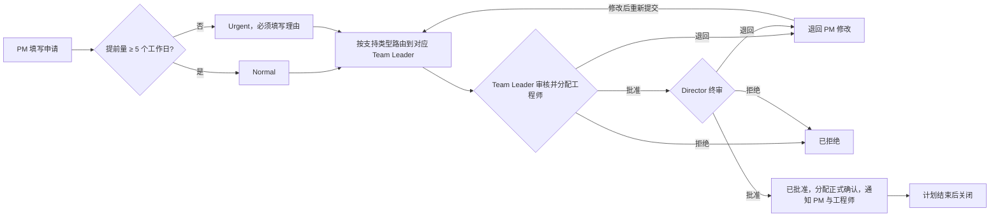
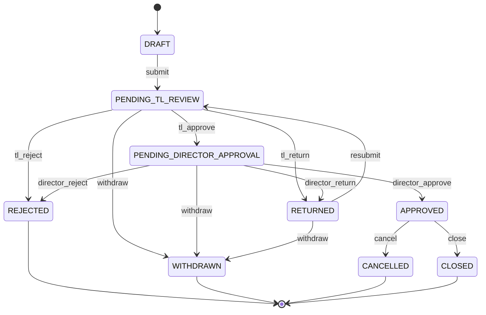
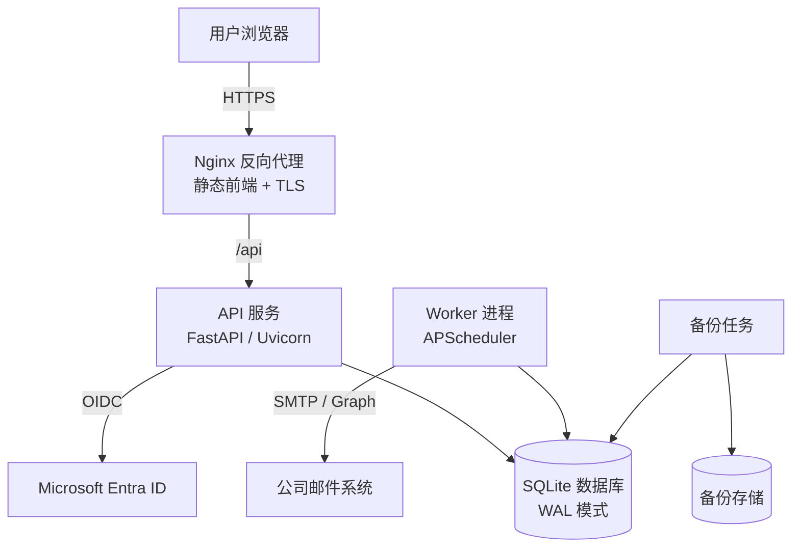
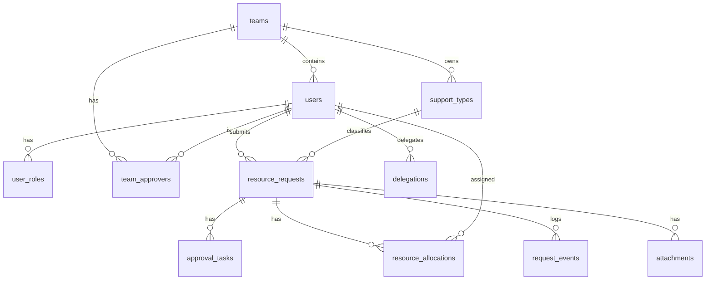

# 工程资源申请系统（Engineering Resource Request System）系统设计说明书

| 项目 | 内容 |
| --- | --- |
| 文档版本 | v0.2（与第一版实现同步） |
| 编写日期 | 2026-11-05 |
| 适用范围 | 工程部 Support Team 与 Dev Team 的项目及 SR 资源申请、审批与分配 |
| 数据库 | SQLite（按可迁移至 PostgreSQL 的方式设计） |


> **v0.2 实施说明。** 第一版实现与本设计一致，但根据部署环境做了以下调整：
>
> 1. **登录方式**：第一版使用系统自带的账号密码登录（Argon2 哈希、服务器端会话、CSRF 校验、连续失败锁定），暂不接入 Entra ID 单点登录。管理员在系统中创建账号并发放临时密码，用户首次登录时必须修改密码。
> 2. **反向代理**：部署在已运行 PMate 的 Google Cloud e2-micro 服务器上，复用现有的 Caddy（自动 HTTPS），不使用 Nginx。Caddy 直接托管前端静态文件，并把 `/api/*` 转发给只监听 `127.0.0.1:8100` 的后端。
> 3. **进程模型**：为节省内存，后台任务默认在 API 进程内运行（`ERF_RUN_SCHEDULER=true`）。如需拆分，可关闭该开关并运行 `python -m erf.worker`。
> 4. **审批时分配**：Team Leader 在批准时必须选择工程师，分配与审批决定在同一个请求中原子完成（`POST /requests/{id}/decision` 携带 `engineer_ids`），没有单独的分配接口。
> 5. **暂缓到第二阶段**：代理审批、附件上传和 MS Forms 历史数据导入尚未实现。
> 6. **支持类型与假期**：“Type of support” 的五个选项和新加坡公共假期都是预置的示例数据，管理员可以在“Settings”页面中修改，正式使用前需要业务方确认。

---

## 1. 背景与目标

### 1.1 背景

部门此前使用 Microsoft Forms 收集资源申请，并依靠 Power Automate 把申请自动推送给审批人。由于 Power Automate 已被禁用，表单提交后无法自动流转，审批只能依靠人工转发邮件和手工跟踪，这与管理层提出的“提前计划、分级审批、全程记录、便于治理”的要求不一致。

### 1.2 管理要求（来自部门通知）

1. 所有项目或 SR 的资源申请必须提前计划，并通过统一的在线表单提交。
2. 审批、资源分配至少需要 **5 个工作日**。
3. 申请会被路由到对应的 Resource Manager（即 Team Leader）审批。
4. 提前量不足 5 个工作日的申请被视为 **紧急申请（Urgent）**，必须填写理由，能否支持取决于资源可用性和审批结果。
5. 所有申请都需要被记录和跟踪，以支撑资源规划、透明度和治理。

### 1.3 系统目标

本系统的目标是用一个独立部署的内部 Web 应用替代 “MS Forms + Power Automate” 的组合，并实现以下能力：

- 提供与现有表单字段一致的在线申请界面，并在前端和后端同时执行业务校验。
- 根据提交日期、计划开始日期和公共假期日历，自动计算提前工作日数，并自动判定是否为紧急申请。
- 按支持类型自动把申请路由到对应团队的 Team Leader，Team Leader 批准后自动流转到 Director，无需任何人工转发。
- 在每个流程节点自动发送邮件通知，并对超时未处理的审批发送提醒。
- 由 Team Leader 在审批时完成具体工程师的分配，并在 Director 批准后正式确认分配。
- 完整记录每一次操作，形成可审计的历史，并提供资源负载视图和统计报表。

### 1.4 非目标

第一阶段不包含工时填报、项目财务核算和与外部 PMO 系统的集成。这些内容可以在后续版本中通过开放 API 扩展。

---

## 2. 角色与权限

### 2.1 角色定义

| 角色 | 说明 |
| --- | --- |
| Requester（PM） | 发起申请的项目经理或销售支持人员。可以创建、提交、撤回自己的申请，并在被退回后修改再提交。 |
| Team Leader（Resource Manager） | Support Team 或 Dev Team 的负责人。负责审核本团队收到的申请，分配具体工程师，并决定批准、退回或拒绝。 |
| Director | 部门总监。对 Team Leader 已审核的申请做最终审批。 |
| Engineer | 被分配的工程师或开发人员。可以查看分配给自己的任务，并在分配确认后收到通知。 |
| Admin | 系统管理员。维护用户、团队、支持类型、假期日历、审批路由和系统参数。 |
| Viewer（可选） | 管理层或 PMO 的只读角色，可以查看全部申请和报表。 |

一个用户可以同时拥有多个角色。例如，Team Leader 在为自己的项目申请资源时，也以 Requester 的身份提交申请。

### 2.2 权限矩阵

| 操作 | Requester | Team Leader | Director | Engineer | Admin |
| --- | --- | --- | --- | --- | --- |
| 创建、编辑草稿 | 本人 | 本人 | 本人 | — | — |
| 提交申请 | 本人 | 本人 | 本人 | — | — |
| 撤回申请（终审前） | 本人 | — | — | — | 可以 |
| 查看申请 | 本人 | 本团队全部 | 全部 | 分配给本人的 | 全部 |
| 分配工程师 | — | 本团队 | 可调整 | — | — |
| Team Leader 审批 | — | 本团队 | — | — | — |
| Director 审批 | — | — | 可以 | — | — |
| 查看资源负载 | — | 本团队 | 全部 | — | 全部 |
| 查看报表 | — | 本团队 | 全部 | — | 全部 |
| 系统配置 | — | — | — | — | 可以 |

权限检查统一在后端的服务层执行，前端只负责根据权限隐藏或禁用按钮，不能作为安全边界。

---

## 3. 业务流程设计

### 3.1 主流程



### 3.2 状态机

申请单的状态由一个显式的状态机管理。所有状态变化都只能通过预先定义的转换完成，任何不在转换表中的操作都会被后端拒绝。



| 状态 | 含义 | 当前处理人 |
| --- | --- | --- |
| DRAFT | 草稿，尚未提交 | 申请人 |
| PENDING_TL_REVIEW | 等待 Team Leader 审核与分配 | 对应团队的 Team Leader（或其代理人） |
| PENDING_DIRECTOR_APPROVAL | 等待 Director 终审 | Director（或其代理人） |
| RETURNED | 被退回，等待申请人修改 | 申请人 |
| APPROVED | 已批准，资源分配已确认 | — |
| REJECTED | 已拒绝（终态） | — |
| WITHDRAWN | 申请人在终审前撤回（终态） | — |
| CANCELLED | 批准后因项目变化而取消，已释放资源（终态） | — |
| CLOSED | 计划结束日期已过，系统自动关闭或由 PM 手动关闭（终态） | — |

### 3.3 关键业务规则

**规则 1：紧急申请的自动判定。** 系统在提交时计算“提前工作日数”，即从提交日的次日起，到计划开始日的前一天为止，扣除周末和公共假期后的天数。如果结果小于系统参数 `min_notice_working_days`（默认值为 5），系统会把申请强制标记为 Urgent，并要求填写理由。申请人也可以在提前量充足的情况下主动选择 Urgent，此时同样需要填写理由。为了避免 PM 先保存草稿、过几天再提交来规避规则，计算始终以 **实际提交时间** 为准；被退回后重新提交时，系统会重新计算一次。

**规则 2：字段的条件必填。** “Man-days awarded / Approved allocation” 只对 Request Type 为 Project 的申请必填，并且必须是正数；对于 Pre-sales 和 Other 类型，系统会提供“不适用”选项，并在数据库中存为空值，而不是存储字符串 “N/A”。“Justification” 只在 Urgent 时必填。原表单要求用户手工输入 “N/A”，新系统改为由界面根据条件自动显示或隐藏字段，这样可以保证数据干净，便于统计。

**规则 3：日期校验。** 计划开始日期不能早于提交日期，计划结束日期不能早于开始日期。

**规则 4：审批路由。** 每种支持类型（Type of support）都在配置表中映射到一个团队（Support 或 Dev），每个团队配置一名或多名审批人。如果配置了多名审批人，任意一人处理即视为该节点完成，其余人的待办会自动关闭。Director 节点的审批人同样通过配置指定。

**规则 5：分配与审批的关系。** Team Leader 在批准时必须至少分配一名工程师。如果分配人数少于申请人数，系统要求 Team Leader 填写说明。分配记录在 Team Leader 批准时处于 PROPOSED（建议）状态，在 Director 批准后变为 CONFIRMED（确认）状态，在申请被拒绝、撤回或取消时变为 RELEASED（释放）状态。资源负载视图会同时显示建议和确认的分配，以便 Team Leader 发现冲突。

**规则 6：退回与拒绝的区别。** 退回表示申请需要补充或修改，申请人修改后可以重新提交，审批轮次加一，并重新从 Team Leader 节点开始。拒绝是终态，申请人需要重新发起新的申请。退回和拒绝都必须填写意见。

**规则 7：代理审批。** 审批人可以设置休假期间的代理人。在代理有效期内，新产生的待办会同时分配给代理人，审计记录会明确标注“由某人代某人审批”。

**规则 8：超时提醒与升级。** 待办超过系统参数规定的工作日数（建议 Normal 为 2 个工作日，Urgent 为 4 个工作小时）仍未处理时，系统发送提醒邮件；超过第二个阈值时抄送给 Director 或 Admin。提醒只发送通知，不会自动审批。

**规则 9：并发安全。** 两名审批人同时操作同一张申请单时，只有第一个操作会成功，第二个操作会收到“该申请已被处理”的提示。实现方式见第 6.4 节。

---

## 4. 技术选型建议

### 4.1 推荐方案

| 层次 | 推荐技术 | 选择理由 |
| --- | --- | --- |
| 后端框架 | Python 3.12 + FastAPI | 开发效率高，自带 OpenAPI 文档，类型提示完整，适合中小型内部系统。 |
| ORM 与迁移 | SQLAlchemy 2.0 + Alembic | 业界标准，便于以后从 SQLite 迁移到 PostgreSQL，数据库结构变更全部通过版本化迁移脚本管理。 |
| 数据校验 | Pydantic v2 | 请求和响应模型与 FastAPI 原生集成。 |
| 后台任务 | APScheduler（独立 worker 进程） | 负责发送邮件、超时提醒和自动关闭，不依赖额外的消息中间件。 |
| 邮件 | SMTP（公司 Exchange 中继）或 Microsoft Graph `sendMail` | 不依赖 Power Automate。邮件模板使用 Jinja2。 |
| 认证 | Microsoft Entra ID（Azure AD）OIDC 单点登录 | 员工无需另设密码，离职账号自动失效。若 IT 不批准注册应用，可退回到本地账号加 Argon2 密码哈希的方案。 |
| 前端 | Vue 3 + TypeScript + Vite + Element Plus + Pinia | 组件库成熟，表格、表单、日期选择器等企业组件开箱即用。 |
| 数据库 | SQLite 3（WAL 模式） | 符合要求，零运维。在几十到一两百名用户的规模下性能足够。 |
| 部署 | Docker Compose + Nginx（HTTPS 反向代理） | 一台内部 Linux 或 Windows Server 即可运行，便于迁移和恢复。 |
| 测试 | pytest、Vitest、Playwright | 分别覆盖后端单元与集成测试、前端组件测试和端到端流程测试。 |
| 代码质量 | Ruff、mypy、ESLint、vue-tsc、pre-commit | 在提交前和 CI 中统一检查。 |

如果团队更熟悉 .NET，可以用 ASP.NET Core + EF Core + Hangfire 实现完全相同的分层架构，本文档的数据模型、状态机和接口设计保持不变。选择哪种技术栈，主要取决于后续由谁来维护这个系统。

### 4.2 关于 SQLite 的使用建议

SQLite 完全可以支撑这个系统，但需要按照生产环境的方式使用，而不是使用默认配置：

- 启用 `PRAGMA journal_mode=WAL`，使读操作和写操作可以并发进行。
- 设置 `PRAGMA busy_timeout=5000`，避免短暂写锁直接导致请求失败。
- 每个连接都启用 `PRAGMA foreign_keys=ON`，因为 SQLite 默认不检查外键。
- 设置 `PRAGMA synchronous=NORMAL`，在 WAL 模式下兼顾安全性和性能。
- 写操作的事务要保持简短，不要在事务中发送邮件或调用外部接口。邮件通过下文的 Outbox 表异步发送。
- 只允许一个后台 worker 进程执行定时任务，避免重复发送提醒。
- 备份使用 SQLite 在线备份 API（`sqlite3 .backup` 或 Python 的 `Connection.backup`），每天执行一次，保留 30 天，并复制到另一台机器或网络存储上。不要直接复制正在使用的数据库文件。如有需要，可以使用 Litestream 做持续复制。
- 所有数据访问都通过 Repository 层进行，不在业务代码中写 SQLite 特有的语法。这样当用户规模增长时，只需要修改连接字符串并执行迁移，就可以切换到 PostgreSQL。

### 4.3 关于通知渠道的建议

Power Automate 被禁用后，Teams 的 “Workflows” 连接器通常也会受到影响，因此第一阶段建议以邮件作为唯一的可靠通知渠道。邮件中提供直达申请详情页的链接，审批人点击后登录系统完成操作。

出于安全考虑，不建议在邮件中放置“一键批准”按钮。这类链接一旦被转发或被邮件安全网关预扫描，就可能产生误操作。如果业务上确实需要，应使用一次性、短时效、绑定审批人的签名令牌，并且仍要求用户在页面上二次确认。

在实施前需要与 IT 确认以下其中一项：是否可以使用内部 SMTP 中继，或者是否可以注册一个具有 `Mail.Send` 权限的 Entra ID 应用。

---

## 5. 系统架构

### 5.1 部署架构



API 服务和 Worker 是同一个代码库的两个入口，它们共享领域模型和数据访问层，但运行在不同的进程中。API 进程只负责处理用户请求，并在同一个数据库事务中写入业务数据和待发送的通知；Worker 进程负责从 Outbox 表中读取通知并发送，同时执行定时提醒和自动关闭任务。这样即使邮件服务器暂时不可用，用户的审批操作也不会失败，通知会在邮件服务恢复后自动重试。

### 5.2 后端分层架构

后端采用分层架构，每一层只依赖它下面的层，依赖方向是单向的：

| 层次 | 职责 | 不应包含的内容 |
| --- | --- | --- |
| API 层（`api/`） | 定义路由、解析请求、调用服务、返回响应，以及注入当前用户和数据库会话 | 业务规则和 SQL |
| 服务层（`services/`） | 编排一个完整的用例，例如“提交申请”或“Team Leader 批准”，负责权限检查和事务边界 | HTTP 相关的对象 |
| 领域层（`domain/`） | 纯业务逻辑，包括状态机、工作日计算、紧急判定规则和校验规则 | 数据库访问和框架依赖 |
| 仓储层（`repositories/`） | 封装数据查询和持久化 | 业务判断 |
| 数据模型层（`db/models/`） | SQLAlchemy ORM 实体定义 | 业务逻辑 |
| 基础设施（`infrastructure/`） | 邮件发送、身份认证提供方、文件存储等外部依赖的适配器 | 业务逻辑 |

领域层不依赖任何框架，因此可以用纯单元测试覆盖最关键的规则，例如工作日计算和状态转换。

### 5.3 工作流引擎的设计思路

本系统的审批流程相对固定（两级审批），因此不建议引入 Camunda 或 Flowable 这类重量级 BPM 引擎，因为它们的部署和维护成本远远超过收益。推荐的做法是“代码定义状态机 + 数据库配置审批人”：

- 状态和合法的转换在 `domain/workflow.py` 中以声明式的转换表定义。每个转换包括来源状态、目标状态、允许执行的角色和执行前的校验条件。
- 每个审批节点由谁处理，通过 `teams`、`team_approvers`、`support_types` 和 `system_settings` 表配置。管理员可以在后台调整，无需修改代码。
- 每次进入一个审批节点，系统都会创建一条 `approval_tasks` 记录，作为该审批人的待办。节点完成后，同一节点的其他待办会被自动关闭。
- 每次状态变化都会在同一事务中写入 `request_events`（审计日志）和 `notification_outbox`（待发送的通知）。

如果将来需要增加审批节点（例如在 Director 之后增加 PMO 确认），只需要在转换表中增加状态和转换，并配置审批人即可，不需要重写现有逻辑。

---

## 6. 数据库设计

### 6.1 实体关系概览



### 6.2 表结构

以下所有表都包含 `created_at` 和 `updated_at` 字段（UTC 时间，ISO 8601 格式存储），下文不再重复列出。主键统一使用自增整数，对外展示的单号使用业务编号。

**users（用户）**

| 字段 | 类型 | 约束 | 说明 |
| --- | --- | --- | --- |
| id | INTEGER | PK | |
| email | TEXT | UNIQUE, NOT NULL | 登录标识，统一转为小写 |
| display_name | TEXT | NOT NULL | |
| external_id | TEXT | UNIQUE | Entra ID 的对象 ID |
| team_id | INTEGER | FK → teams.id | 所属团队；PM 可以为空 |
| job_title | TEXT | | |
| is_engineer | INTEGER | NOT NULL DEFAULT 0 | 是否可以被分配到项目 |
| is_active | INTEGER | NOT NULL DEFAULT 1 | 离职或停用时设为 0，不做物理删除 |

**roles / user_roles（角色）**

`roles` 表保存 `REQUESTER`、`TEAM_LEADER`、`DIRECTOR`、`ADMIN`、`VIEWER` 等角色代码；`user_roles(user_id, role_id)` 使用联合主键，表示多对多关系。

**teams（团队）**

| 字段 | 类型 | 约束 | 说明 |
| --- | --- | --- | --- |
| id | INTEGER | PK | |
| code | TEXT | UNIQUE, NOT NULL | 例如 `SUPPORT`、`DEV` |
| name | TEXT | NOT NULL | |
| is_active | INTEGER | NOT NULL DEFAULT 1 | |

**team_approvers（团队审批人）**

| 字段 | 类型 | 约束 | 说明 |
| --- | --- | --- | --- |
| team_id | INTEGER | FK, PK | |
| user_id | INTEGER | FK, PK | |
| is_primary | INTEGER | NOT NULL DEFAULT 1 | 主审批人或备选审批人 |

**support_types（支持类型）**

| 字段 | 类型 | 约束 | 说明 |
| --- | --- | --- | --- |
| id | INTEGER | PK | |
| code | TEXT | UNIQUE, NOT NULL | |
| name | TEXT | NOT NULL | 例如 Project Engineer |
| team_id | INTEGER | FK, NOT NULL | 决定路由到哪个团队 |
| sort_order | INTEGER | NOT NULL DEFAULT 0 | |
| is_active | INTEGER | NOT NULL DEFAULT 1 | |

**resource_requests（资源申请，核心表）**

| 字段 | 类型 | 约束 | 对应表单字段 |
| --- | --- | --- | --- |
| id | INTEGER | PK | |
| request_no | TEXT | UNIQUE | 业务单号，例如 `ERR-2026-0144`，在首次提交时生成 |
| requester_id | INTEGER | FK, NOT NULL | 提交人（替代 MS Forms 自动记录的姓名和邮箱） |
| request_type | TEXT | NOT NULL, CHECK IN ('PROJECT','PRESALES','OTHER') | 1. Request Type |
| priority_declared | TEXT | NOT NULL, CHECK IN ('NORMAL','URGENT') | 2. Priority（申请人选择的值） |
| is_urgent | INTEGER | NOT NULL | 系统最终判定结果 |
| urgency_reason | TEXT | CHECK IN ('SHORT_NOTICE','DECLARED') | 紧急的原因：提前量不足或主动声明 |
| notice_working_days | INTEGER | | 提交时计算出的提前工作日数 |
| project_name | TEXT | NOT NULL | 3. Project / Opportunity name |
| wbs_code | TEXT | | 4. Project / WBS Code |
| client_name | TEXT | NOT NULL | 5. Client Name |
| support_type_id | INTEGER | FK, NOT NULL | 6. Type of support |
| team_id | INTEGER | FK, NOT NULL | 根据支持类型冗余存储，便于查询和报表 |
| headcount | INTEGER | NOT NULL, CHECK > 0 | 7. Number of engineers/developers required |
| preferred_engineers_note | TEXT | | 8. Preferred engineers（自由文本补充） |
| man_days | REAL | CHECK (man_days IS NULL OR man_days > 0) | 9. Man-days awarded；非 Project 类型可以为空 |
| planned_start | TEXT(date) | NOT NULL | 10. From |
| planned_end | TEXT(date) | NOT NULL, CHECK ≥ planned_start | 11. To |
| scope_description | TEXT | NOT NULL | 12. Scope Description |
| task_schedule | TEXT | NOT NULL | 13. Detailed task schedule with timing |
| urgent_justification | TEXT | | 14. Justification，Urgent 时必填（由服务层校验） |
| status | TEXT | NOT NULL | 见状态机 |
| round | INTEGER | NOT NULL DEFAULT 1 | 审批轮次，每次重新提交加一 |
| submitted_at | TEXT | | 最近一次提交时间 |
| decided_at | TEXT | | 终审时间 |
| version | INTEGER | NOT NULL DEFAULT 1 | 乐观锁版本号 |

建议的索引包括 `(status, team_id)`、`(requester_id, status)` 和 `(planned_start, planned_end)`。

**request_preferred_engineers（首选工程师）**

`(request_id, user_id)` 联合主键。表单原来是自由文本，新系统建议改为从工程师列表中选择，这样 Team Leader 在分配时可以直接看到首选人员；同时保留自由文本字段，用于填写外部人员或补充说明。

**approval_tasks（审批待办）**

| 字段 | 类型 | 约束 | 说明 |
| --- | --- | --- | --- |
| id | INTEGER | PK | |
| request_id | INTEGER | FK, NOT NULL | |
| round | INTEGER | NOT NULL | 对应的审批轮次 |
| step | TEXT | NOT NULL | `TL_REVIEW` 或 `DIRECTOR_APPROVAL` |
| assignee_id | INTEGER | FK, NOT NULL | 待办所属的审批人 |
| on_behalf_of_id | INTEGER | FK | 代理审批时记录被代理人 |
| status | TEXT | NOT NULL | `PENDING`、`APPROVED`、`RETURNED`、`REJECTED`、`CLOSED`（被他人处理后自动关闭） |
| decision_comment | TEXT | | |
| due_at | TEXT | | 按工作日计算的处理期限 |
| reminded_count | INTEGER | NOT NULL DEFAULT 0 | |
| acted_at | TEXT | | |

**resource_allocations（资源分配）**

| 字段 | 类型 | 约束 | 说明 |
| --- | --- | --- | --- |
| id | INTEGER | PK | |
| request_id | INTEGER | FK, NOT NULL | |
| engineer_id | INTEGER | FK, NOT NULL | |
| start_date | TEXT | NOT NULL | 默认等于申请的计划日期，可以单独调整 |
| end_date | TEXT | NOT NULL | |
| allocation_pct | INTEGER | NOT NULL DEFAULT 100 | 投入比例，用于负载计算 |
| status | TEXT | NOT NULL | `PROPOSED`、`CONFIRMED`、`RELEASED` |
| allocated_by_id | INTEGER | FK, NOT NULL | |

同一张申请单中，同一名工程师只能有一条有效分配（唯一约束可通过部分索引实现：`WHERE status != 'RELEASED'`）。

**request_events（审计日志）**

| 字段 | 类型 | 说明 |
| --- | --- | --- |
| id | INTEGER | PK |
| request_id | INTEGER | FK |
| actor_id | INTEGER | 操作人；系统任务为空 |
| action | TEXT | 例如 `SUBMIT`、`TL_APPROVE`、`ALLOCATE`、`REMIND` |
| from_status / to_status | TEXT | 状态变化 |
| comment | TEXT | 意见 |
| payload | TEXT(JSON) | 变更前后的字段差异等补充信息 |

审计日志只允许插入，不允许修改或删除。

**attachments（附件）**

保存文件名、存储路径、大小、MIME 类型、SHA-256 校验值和上传人。文件本身存放在服务器的数据目录中，不存入 SQLite。建议限制单个文件不超过 10 MB，并限制可上传的文件类型。

**notification_outbox（通知发件箱）**

| 字段 | 类型 | 说明 |
| --- | --- | --- |
| id | INTEGER | PK |
| event_type | TEXT | 例如 `REQUEST_SUBMITTED`、`TASK_REMINDER` |
| request_id | INTEGER | 关联的申请 |
| to_addresses / cc_addresses | TEXT(JSON) | 收件人 |
| subject / body_html | TEXT | 渲染后的邮件内容 |
| status | TEXT | `PENDING`、`SENT`、`FAILED` |
| attempts | INTEGER | 已尝试次数 |
| next_attempt_at | TEXT | 下次重试时间（指数退避） |
| last_error | TEXT | 最近一次失败原因 |
| sent_at | TEXT | |

**holidays（公共假期）**：`holiday_date`（唯一）、`name`、`country_code`。由管理员每年导入下一年的假期。

**delegations（代理设置）**：`user_id`、`delegate_id`、`start_date`、`end_date`、`is_active`。

**system_settings（系统参数）**：`key`、`value`、`description`。例如 `min_notice_working_days=5`、`reminder_after_working_days=2`、`escalate_after_working_days=4`、`request_no_prefix=ERR`。

**sequences（单号序列）**：`name`、`year`、`next_value`。在提交事务中加一，用于生成按年份重新编号的连续单号。

### 6.3 不做物理删除

申请、用户、团队和支持类型都不做物理删除。申请只能被撤回、拒绝或取消；配置数据通过 `is_active` 停用。这样可以保证历史报表和审计记录始终完整。

### 6.4 并发控制

每一次状态转换都使用带条件的更新语句，例如：

```sql
UPDATE resource_requests
SET status = 'PENDING_DIRECTOR_APPROVAL', version = version + 1, updated_at = :now
WHERE id = :id AND status = 'PENDING_TL_REVIEW' AND version = :expected_version;
```

如果受影响的行数为 0，说明申请已经被其他人处理或修改，服务层会抛出 `ConflictError`，前端提示用户刷新页面。这种方式不依赖数据库锁，在 SQLite 和 PostgreSQL 上的行为一致。

---

## 7. 接口设计（REST API v1）

所有接口都以 `/api/v1` 为前缀，使用 JSON 格式，错误响应统一为 `{ "code": "...", "message": "...", "details": {...} }`。

| 方法 | 路径 | 说明 |
| --- | --- | --- |
| GET | `/auth/login`、`/auth/callback`、`/auth/logout` | Entra ID 单点登录 |
| GET | `/me` | 当前用户信息、角色和待办数量 |
| GET | `/requests` | 申请列表，支持按状态、团队、类型、日期、关键字筛选和分页 |
| POST | `/requests` | 创建草稿 |
| GET | `/requests/{id}` | 申请详情，包括分配、待办和审计历史 |
| PATCH | `/requests/{id}` | 修改草稿或被退回的申请（需要携带 `version`） |
| POST | `/requests/{id}/submit` | 提交或重新提交 |
| POST | `/requests/{id}/withdraw` | 撤回 |
| POST | `/requests/{id}/cancel` | 批准后取消 |
| POST | `/requests/{id}/decision` | 审批决定，请求体为 `{ action: APPROVE / RETURN / REJECT, comment, version }` |
| PUT | `/requests/{id}/allocations` | Team Leader 设置建议分配 |
| POST | `/requests/notice-preview` | 输入开始日期，返回提前工作日数和是否紧急（供表单实时显示） |
| GET | `/tasks/mine` | 我的待办 |
| GET | `/engineers/load` | 指定团队和日期范围内的工程师负载 |
| GET | `/reports/summary` | 统计报表 |
| GET | `/reports/export` | 导出 Excel |
| GET/POST/PATCH | `/admin/users`、`/admin/teams`、`/admin/support-types`、`/admin/holidays`、`/admin/settings`、`/admin/delegations` | 系统配置 |

审批接口没有为每一种动作单独设计路径，而是统一使用 `/decision`。服务层根据申请的当前状态和当前用户的角色，在状态机中查找对应的转换，这样可以避免前后端各自维护一份流程逻辑。

---

## 8. 通知设计

| 触发事件 | 收件人 | 抄送 | 邮件内容要点 |
| --- | --- | --- | --- |
| 提交或重新提交 | 对应团队的 Team Leader | 申请人 | 申请摘要、是否紧急、提前工作日数、处理链接 |
| Team Leader 批准 | Director | 申请人 | 申请摘要、建议分配名单、Team Leader 意见 |
| Director 批准 | 申请人、被分配的工程师 | Team Leader | 确认的分配名单、计划日期、工作范围 |
| 退回 | 申请人 | 上一节点审批人 | 退回意见和修改链接 |
| 拒绝 | 申请人 | Team Leader | 拒绝意见 |
| 撤回或取消 | 当前待办处理人、已分配的工程师 | — | 资源释放说明 |
| 待办超时提醒 | 待办处理人 | 超过升级阈值时抄送 Director 或 Admin | 已等待的工作日数 |
| 计划开始前 1 个工作日 | 申请人、被分配的工程师 | — | 开工提醒（可选） |

Urgent 申请的邮件主题统一加上 `[URGENT]` 前缀，方便审批人在收件箱中识别。

---

## 9. 代码结构

```text
erf-system/
├── README.md
├── docs/
│   ├── 系统设计说明书.md
│   ├── adr/                         # 架构决策记录（例如为何选择 SQLite、为何不用 BPM 引擎）
│   └── api/                         # 导出的 OpenAPI 文档
├── backend/
│   ├── pyproject.toml               # 依赖、Ruff、mypy、pytest 配置
│   ├── alembic.ini
│   ├── .env.example
│   ├── migrations/                  # Alembic 迁移脚本
│   │   └── versions/
│   ├── src/erf/
│   │   ├── __init__.py
│   │   ├── main.py                  # API 入口：创建 FastAPI 应用、注册路由和中间件
│   │   ├── worker.py                # Worker 入口：启动定时任务
│   │   ├── core/
│   │   │   ├── config.py            # 基于 pydantic-settings 的配置
│   │   │   ├── logging.py           # 结构化日志
│   │   │   ├── errors.py            # 业务异常和统一错误响应
│   │   │   └── clock.py             # 可注入的时钟，便于测试日期逻辑
│   │   ├── domain/
│   │   │   ├── enums.py             # 状态、类型、动作等枚举
│   │   │   ├── workflow.py          # 状态机与转换表
│   │   │   ├── calendar.py          # 工作日计算
│   │   │   ├── urgency.py           # 紧急判定规则
│   │   │   └── validation.py        # 条件必填等跨字段校验
│   │   ├── db/
│   │   │   ├── base.py              # Declarative Base 与公共字段
│   │   │   ├── session.py           # 引擎、会话和 SQLite PRAGMA 设置
│   │   │   └── models/              # 每个聚合一个文件
│   │   │       ├── user.py
│   │   │       ├── team.py
│   │   │       ├── request.py
│   │   │       ├── approval.py
│   │   │       ├── allocation.py
│   │   │       ├── audit.py
│   │   │       ├── notification.py
│   │   │       └── settings.py
│   │   ├── repositories/
│   │   │   ├── base.py
│   │   │   ├── request_repo.py
│   │   │   ├── user_repo.py
│   │   │   ├── allocation_repo.py
│   │   │   └── ...
│   │   ├── services/
│   │   │   ├── request_service.py   # 创建、修改、提交、撤回、取消
│   │   │   ├── approval_service.py  # 审批决定与路由
│   │   │   ├── allocation_service.py
│   │   │   ├── routing_service.py   # 解析各节点的审批人（含代理）
│   │   │   ├── notification_service.py  # 渲染模板并写入 Outbox
│   │   │   ├── report_service.py
│   │   │   └── admin_service.py
│   │   ├── infrastructure/
│   │   │   ├── mail/
│   │   │   │   ├── base.py          # MailSender 接口
│   │   │   │   ├── smtp_sender.py
│   │   │   │   └── graph_sender.py
│   │   │   ├── auth/
│   │   │   │   └── entra_oidc.py
│   │   │   └── storage/
│   │   │       └── local_storage.py
│   │   ├── jobs/
│   │   │   ├── dispatch_outbox.py   # 发送邮件并重试
│   │   │   ├── send_reminders.py    # 超时提醒与升级
│   │   │   └── auto_close.py        # 自动关闭已结束的申请
│   │   ├── schemas/                 # Pydantic 请求与响应模型
│   │   ├── api/
│   │   │   ├── deps.py              # 当前用户、数据库会话、权限依赖
│   │   │   └── v1/
│   │   │       ├── router.py
│   │   │       ├── auth.py
│   │   │       ├── requests.py
│   │   │       ├── tasks.py
│   │   │       ├── engineers.py
│   │   │       ├── reports.py
│   │   │       └── admin.py
│   │   └── templates/email/         # Jinja2 邮件模板
│   ├── scripts/
│   │   ├── seed.py                  # 初始化角色、团队、支持类型
│   │   ├── import_holidays.py
│   │   ├── import_msforms.py        # 导入 MS Forms 历史数据
│   │   └── backup.py
│   └── tests/
│       ├── unit/                    # 领域层：工作日、状态机、校验
│       ├── integration/             # 服务层与 API（使用临时 SQLite 文件）
│       └── conftest.py
├── frontend/
│   ├── package.json
│   ├── vite.config.ts
│   ├── tsconfig.json
│   └── src/
│       ├── main.ts
│       ├── App.vue
│       ├── router/                  # 路由与基于角色的路由守卫
│       ├── api/                     # 按资源划分的 API 客户端（根据 OpenAPI 生成类型）
│       ├── stores/                  # Pinia：用户会话、待办数量、字典数据
│       ├── views/
│       │   ├── dashboard/
│       │   ├── requests/            # 列表、表单、详情
│       │   ├── approvals/
│       │   ├── resources/           # 资源负载
│       │   ├── reports/
│       │   └── admin/
│       ├── components/              # 状态标签、流程步骤条、时间线等通用组件
│       ├── composables/             # useNoticePreview、usePermission 等
│       ├── types/
│       └── utils/
├── e2e/                             # Playwright 端到端测试
├── deploy/
│   ├── docker-compose.yml
│   ├── Dockerfile.backend
│   ├── Dockerfile.frontend
│   ├── nginx.conf
│   └── backup.cron
└── .github/workflows/ci.yml         # 或公司使用的 CI 平台配置
```

### 9.1 编码规范

- 后端使用 Ruff 统一格式化和静态检查，使用 mypy 严格模式检查类型；前端使用 ESLint、Prettier 和 vue-tsc。
- 所有配置通过环境变量注入，代码库中只提交 `.env.example`，不提交任何密钥。
- 数据库结构的任何变化都必须通过 Alembic 迁移脚本完成，禁止手工修改生产数据库。
- 日期统一处理：数据库中的时间戳以 UTC 存储，业务日期（开始日期、结束日期、假期）以不带时区的 `YYYY-MM-DD` 存储，工作日计算按公司所在时区（例如 Asia/Singapore）进行。
- 领域层的关键规则（工作日计算、紧急判定、状态转换）要求 100% 单元测试覆盖。
- 使用 Git 分支和 Pull Request 进行代码评审，CI 通过后才能合并。

---

## 10. 安全与运维

**认证与会话。** 推荐使用 Entra ID 单点登录。会话令牌保存在 `HttpOnly`、`Secure`、`SameSite=Lax` 的 Cookie 中，修改类请求额外校验 CSRF 令牌。用户首次登录时，系统根据邮箱自动匹配预先导入的用户记录；未被导入的用户只获得 Requester 角色。

**授权。** 每个服务方法在执行前都检查当前用户是否有权操作这条记录，例如 Team Leader 只能审批自己团队的申请。

**审计。** 所有状态变化、分配变化和配置变化都写入审计日志，并记录操作人和时间。

**日志与监控。** 应用日志以 JSON 格式输出，记录请求 ID 以便追踪。建议提供 `/healthz` 接口，供监控系统检查 API、数据库和 Worker 心跳。Outbox 中失败的邮件会在管理页面中显示，管理员可以手动重发。

**备份与恢复。** 每天进行一次在线备份并保留 30 天，每月至少做一次恢复演练。附件目录与数据库一起备份。

**数据迁移。** 提供 `import_msforms.py` 脚本，从 MS Forms 导出的 Excel 中导入历史申请，并将其标记为历史数据，使报表从 2026 年初开始就保持完整。

---

## 11. 分阶段实施建议

**第一阶段（最小可用版本）。** 实现单点登录或本地登录、申请表单、自动紧急判定、两级审批流转、Team Leader 分配工程师、邮件通知、我的申请和我的待办、审计历史，以及基础的系统配置。完成这一阶段后，即可替代当前的 MS Forms 流程。

**第二阶段。** 增加资源负载视图、超时提醒与升级、代理审批、报表与 Excel 导出、附件上传，以及 MS Forms 历史数据导入。

**第三阶段。** 根据使用反馈，考虑增加工程师确认或拒绝分配、计划变更申请、与日历系统集成，或在用户规模增长后迁移到 PostgreSQL。

---

## 12. 需要业务方确认的问题

1. “Type of support” 下拉框的完整选项是什么，每个选项分别属于 Support Team 还是 Dev Team？目前只从表单中看到 “Project Engineer” 一项。
2. 公共假期按哪个国家或地区的日历计算？从客户名称来看可能是新加坡，请确认。
3. 每个团队是否只有一名 Team Leader，还是有多名可互相替代的审批人？Director 是否只有一人？
4. Team Leader 是否必须在审批时分配具体工程师，还是可以先批准、在 Director 批准后再分配？
5. Director 是否需要调整 Team Leader 提出的分配方案，还是只做批准或拒绝？
6. 申请人数大于分配人数时（部分满足），是否允许批准？
7. 公司是否允许使用内部 SMTP 中继，或者为本系统注册 Entra ID 应用（用于单点登录和发送邮件）？
8. 系统部署在哪里（内部 Linux 服务器、Windows Server，还是公司云环境）？由谁负责后续运维？
9. 审批的超时提醒阈值是否采用“Normal 为 2 个工作日、Urgent 为 4 个工作小时”的建议？
10. 是否需要导入 MS Forms 中已有的历史申请数据？
